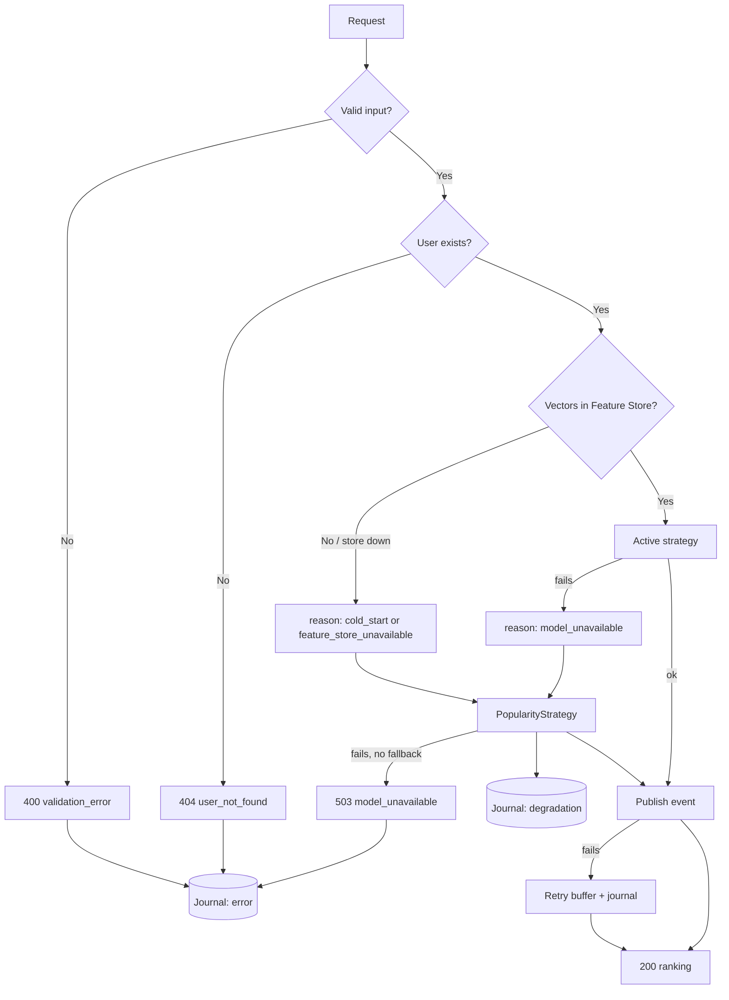

# Error-handling algorithm

The procedure followed by `GET /recommendations/{user_id}?k=K` for every
failure. Each step names the file that implements it. Client-facing messages
are in Spanish (`MENSAJES_ES` in `src/errors.py`); internal messages and logs
stay in English.

## Pseudocode

```
INPUT : user_id, k
OUTPUT: Top-K ranking | translated error

1. VALIDATE input                                   (presentation/schemas.py, application/api.py)
   IF user_id < 1 OR k not in [1, 100]:
        journal(kind=error, code=validation_error)
        RESPOND 400 with a Spanish message                      END

2. CHECK the user exists                            (application/recommendation_controller.py)
   IF the profile is not in the SQL store:
        journal(kind=error, code=user_not_found)
        RESPOND 404 with a Spanish message                      END
   IF the profile store itself fails: continue (never a 500)

3. READ the user vectors from the Feature Store     (data/feature_store_manager.py)
   IF the user is not in the store  -> reason = cold_start
   IF the store cannot be read      -> reason = feature_store_unavailable

4. RANK
   IF reason is set: go to 5
   ELSE run the active strategy (Logging > Timing > Caching > model)
        IF it raises a degradable or unexpected error -> reason = model_unavailable
        IF it raises a non-degradable error           -> propagate (step 7)

5. DEGRADE (only when a reason is set)
   run PopularityStrategy through the same decorator chain
   journal(kind=degradation, code=reason)
   IF Popularity fails:      return an empty ranking, reason = model_unavailable
   IF no fallback exists:    raise ModelUnavailableError -> step 7

6. PUBLISH the "recommendation_served" event (non-blocking)
   IF publishing fails:
        the event is written to the retry buffer (replayed by the worker)
        journal(kind=degradation, code=event_publish_failed)
        the response is NOT affected

7. TRANSLATE platform errors                        (application/api.py, one handler)
   a 200-class error with no possible fallback -> 503
   journal(kind=error) and respond with a Spanish message

8. RESPOND 200 with the ranking (degraded=true when a reason was set)
```

## Flowchart



## Decision table

| Situation | HTTP | Journal entry | What the user sees |
|---|---|---|---|
| Invalid input | 400 | error / validation_error | Spanish message |
| Unknown user | 404 | error / user_not_found | Spanish message |
| No history | 200 (degraded) | degradation / cold_start | Popularity ranking |
| Feature Store down | 200 (degraded) | degradation / feature_store_unavailable | Popularity ranking |
| Model down | 200 (degraded) | degradation / model_unavailable | Popularity ranking |
| Event publish fails | 200 | degradation / event_publish_failed | Normal ranking |
| Nothing can answer | 503 | error / model_unavailable | Spanish message |

## Error journal (bitácora)

- File: `artifacts/logs/errors.jsonl` (override with `RECO_ERROR_LOG_PATH`;
  `/app/data/logs/errors.jsonl` inside the container).
- One JSON object per line: `timestamp`, `kind` (`error` | `degradation`),
  `code`, `status`, `route`, `user_id`, `message`, `detail`.
- Implementation: `src/application/error_journal.py`. Writing the journal can
  never make a request fail.
- It is separate from the FR-06 recommendation history (business data) and
  from the `LoggingDecorator` operational log (latency, cache): the journal
  holds only what failed.
